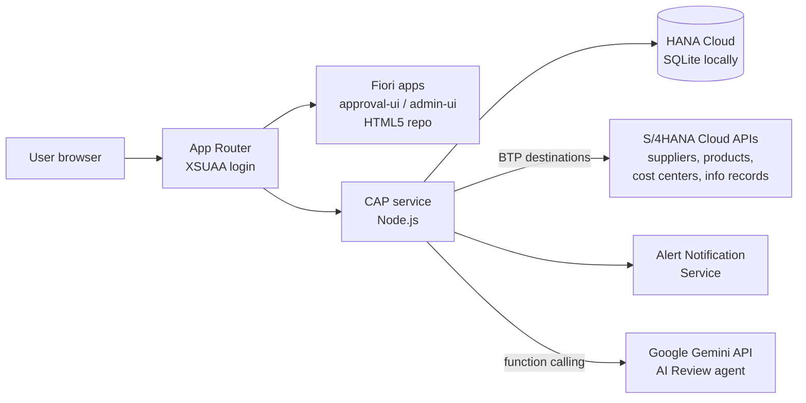
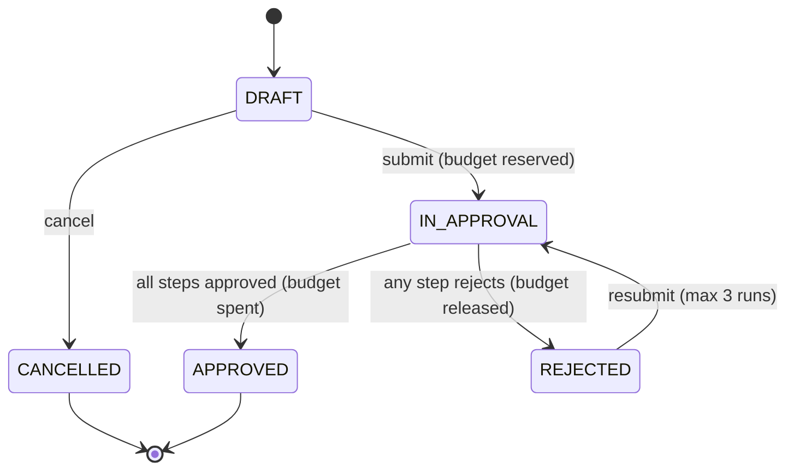
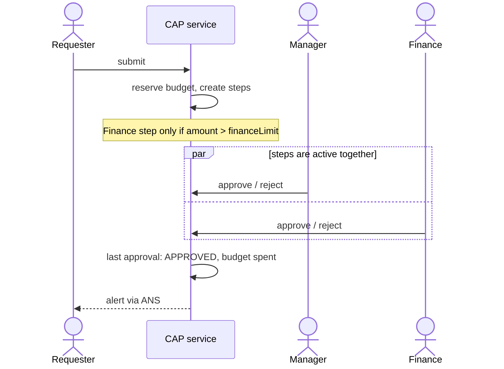
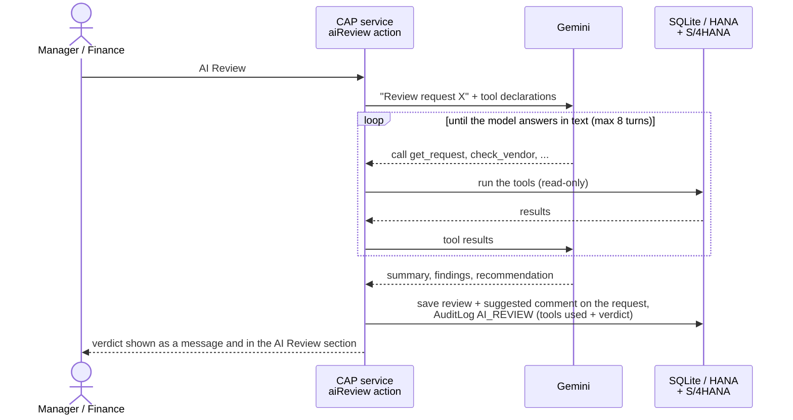
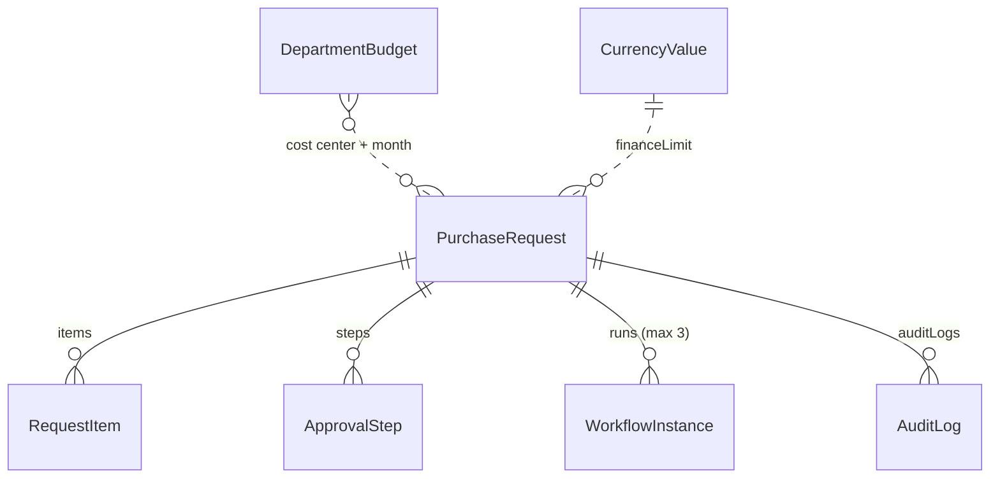

# Enterprise Approval Workflow

A full-stack purchase-request approval system built with SAP CAP, SAP Fiori Elements, and XSUAA.
Requesters raise purchase requests using live S/4HANA master data. Each request reserves part of a monthly
cost-center budget and goes through Manager approval, plus Finance approval when the amount is above a set limit.

<!-- Screenshots: save PNGs to doc/images/ and uncomment.


-->

## Tech Stack
- SAP CAP (Node.js)
- SAP Fiori Elements (UI5): an approval app and an admin app
- SQLite (local) / SAP HANA Cloud (production)
- XSUAA (authentication), SAP Alert Notification Service (alerts)
- Google Gemini API (`@google/genai`, function calling) for the AI Review agent
- SAP S/4HANA Cloud APIs: Business Partner (suppliers), Product, Cost Center, Purchasing Info Record

## Architecture



## Request Lifecycle



A submit that would go over the month's budget is refused, and the request stays where it was.

## Approval Flow



Rules enforced on the server:
- Nobody can approve or reject their own request.
- A two-step approval needs two different people, even if one user holds both roles.
- A rejection needs a comment, and it skips the other open step.

## AI Review Agent

Managers and Finance users get an **AI Review** button on requests waiting for approval.
It starts a tool-using agent: Gemini decides which data it needs, the CAP service runs those tools,
and the loop repeats until the model gives a verdict ending in `Recommendation: APPROVE | REJECT | NEEDS INFO`.



| Tool | What it checks | Source |
|------|----------------|--------|
| `get_request` | Header and items | Database |
| `get_budget` | This month's budget for the cost center | Database |
| `get_approval_history` | Earlier runs, rejection comments, audit log | Database |
| `check_vendor` | Vendor exists, not blocked or deleted | S/4HANA Business Partner |
| `check_price` | Item price vs. the price agreed with the vendor | S/4HANA Purchasing Info Record |
| `find_similar_requests` | Duplicates or split orders for the same vendor and cost center | Database |

The review is saved on the request and shown in an **AI Review** section, so closing the popup doesn't
cost another model run. For REJECT or NEEDS INFO the agent also writes a comment to the requester; the
**Reject** dialog opens with it filled in (`@UI.ParameterDefaultValue`), and the approver can edit it.
The saved review is hidden from requesters, and it is cleared on reject and on resubmit, because it
describes the old version.

Guardrails:
- **Advice only.** Every tool is read-only; the agent cannot approve, reject or change anything.
- Requester-written text (title, justification) is treated as data, not instructions (prompt injection).
- Each model call times out after 30 s and the loop stops after 8 turns. Any failure returns
  "AI review is not available", and the approval workflow keeps working.
- Every review is written to the audit log with the tools the agent used.

The code is in `srv/handlers/ai-review-handler.js`. All model calls go through `srv._llm`, so the tests can
replace it and another provider (e.g. SAP AI Core Generative AI Hub) can be swapped in at that one place.

## Data Model



## Features
- Purchase requests with vendor, product, price and cost center data from S/4HANA
- Monthly budget per cost center: reserved on submit, spent on approval, released on reject; low-budget warning and alert below 10%
- Manager approval; Finance approves too above the per-currency limit (`financeLimit` in `db/data/com.enterprise.approval-CurrencyValue.csv`)
- Two-step approvals need two different people
- Audit logging and role-based access control (`@restrict` row-level rules)
- AI Review agent: Gemini investigates a request with read-only tools and recommends a decision

## Setup
```
npm install
cds watch
```

The S/4HANA sandbox needs an API key from api.sap.com. Put it in `.cdsrc-private.json` (gitignored):

```json
{
  "requires": {
    "S4HANA_SANDBOX":             { "credentials": { "headers": { "APIKey": "<key>" } } },
    "API_PRODUCT_SRV":            { "credentials": { "headers": { "APIKey": "<key>" } } },
    "API_COSTCENTER_SRV":         { "credentials": { "headers": { "APIKey": "<key>" } } },
    "API_INFORECORD_PROCESS_SRV": { "credentials": { "headers": { "APIKey": "<key>" } } }
  }
}
```

In production each API is reached through a BTP destination of the same name.

The AI Review agent needs a Gemini API key, free from aistudio.google.com. Put it in `.env` (gitignored):

```
GEMINI_API_KEY=<key>
# optional, default gemini-3.1-flash-lite
# GEMINI_MODEL=gemini-3.8-flash
```

On the free tier, Google may use the data sent to it, so use sample data only. Busy models can time out on the
free tier; `gemini-3.1-flash-lite` answers fast. Without a key the app works and only AI Review is unavailable.
The server's time zone (`TZ` in `mta.yaml`) decides the budget month.

## Mock Users
Sign in at `http://localhost:4004/login.html`, or click a test user there.

| User | Password | Role |
|------|----------|------|
| test@company.com | test | Requester, Manager, Finance, Admin |
| requester@company.com | requester | Requester |
| manager@company.com | manager | Manager |
| finance@company.com | finance | Finance |
| noaccess@company.com | noaccess | none |

## Tests
```
npm test
```
S/4HANA and Gemini calls are stubbed in the tests, so they run offline. The AI Review tests use a scripted model
that asks for tools and then answers, so the whole agent loop is tested without an API key.

## Further Reading
- [Schema design](doc/01-schema-design.md)
- [Service layer](doc/02-service-layer.md)
- [Handlers](doc/03-handlers.md)
- [XSUAA security](doc/04-xsuaa-security.md)
- [Deployment](doc/05-deployment.md)
- [Architecture decisions](doc/06-architecture-decisions.md)
