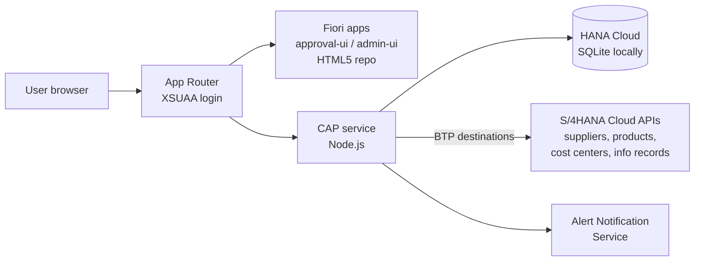
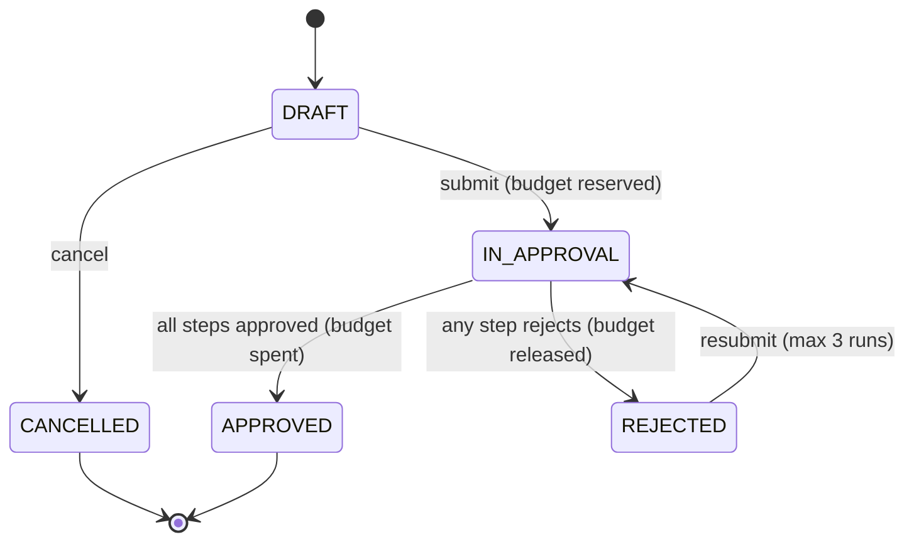
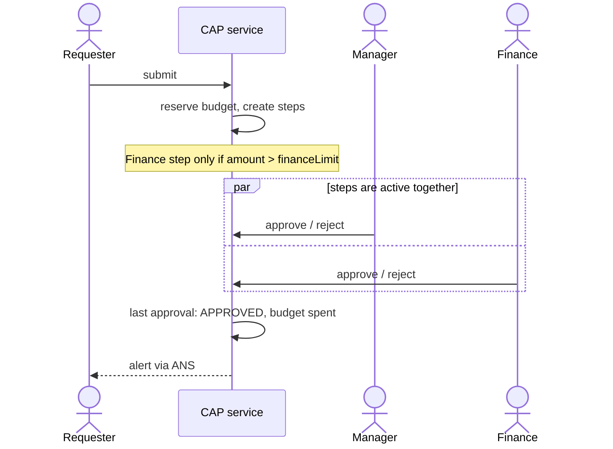
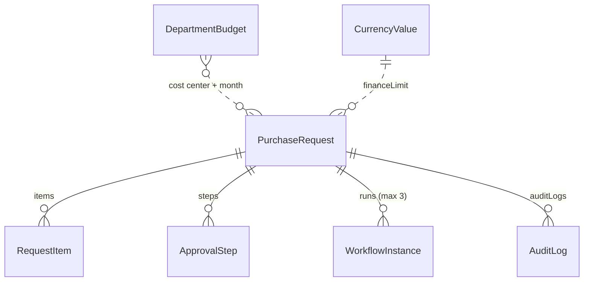

# Enterprise Approval Workflow

A full-stack purchase-request approval system built with SAP CAP, SAP Fiori Elements, and XSUAA.
Requesters raise purchase requests using live S/4HANA master data. Each request reserves part of a monthly
cost-center budget and goes through Manager approval, plus Finance approval when the amount is above a set limit.

<!-- Screenshots: save PNGs to doc/images/ and uncomment.


-->

## Tech Stack
- SAP CAP (Node.js)
- SAP Fiori Elements (UI5): an approval app and an admin app
- SQLite (local) / SAP HANA Cloud (production)
- XSUAA (authentication), SAP Alert Notification Service (alerts)
- SAP S/4HANA Cloud APIs: Business Partner (suppliers), Product, Cost Center, Purchasing Info Record

## Architecture



## Request Lifecycle



A submit that would go over the month's budget is refused, and the request stays where it was.

## Approval Flow



Rules enforced on the server:
- Nobody can approve or reject their own request.
- A two-step approval needs two different people, even if one user holds both roles.
- A rejection needs a comment, and it skips the other open step.

## Data Model



## Features
- Purchase requests with vendor, product, price and cost center data from S/4HANA
- Monthly budget per cost center: reserved on submit, spent on approval, released on reject; low-budget warning and alert below 10%
- Manager approval; Finance approves too above the per-currency limit (`financeLimit` in `db/data/com.enterprise.approval-CurrencyValue.csv`)
- Two-step approvals need two different people
- Audit logging and role-based access control (`@restrict` row-level rules)

## Setup
```
npm install
cds watch
```

The S/4HANA sandbox needs an API key from api.sap.com. Put it in `.cdsrc-private.json` (gitignored):

```json
{
  "requires": {
    "S4HANA_SANDBOX":             { "credentials": { "headers": { "APIKey": "<key>" } } },
    "API_PRODUCT_SRV":            { "credentials": { "headers": { "APIKey": "<key>" } } },
    "API_COSTCENTER_SRV":         { "credentials": { "headers": { "APIKey": "<key>" } } },
    "API_INFORECORD_PROCESS_SRV": { "credentials": { "headers": { "APIKey": "<key>" } } }
  }
}
```

In production each API is reached through a BTP destination of the same name.
The server's time zone (`TZ` in `mta.yaml`) decides the budget month.

## Mock Users
Sign in at `http://localhost:4004/login.html`, or click a test user there.

| User | Password | Role |
|------|----------|------|
| test@company.com | test | Requester, Manager, Finance, Admin |
| requester@company.com | requester | Requester |
| manager@company.com | manager | Manager |
| finance@company.com | finance | Finance |
| noaccess@company.com | noaccess | none |

## Tests
```
npm test
```
S/4HANA calls are stubbed in the tests, so they run offline.

## Further Reading
- [Schema design](doc/01-schema-design.md)
- [Service layer](doc/02-service-layer.md)
- [Handlers](doc/03-handlers.md)
- [XSUAA security](doc/04-xsuaa-security.md)
- [Deployment](doc/05-deployment.md)
- [Architecture decisions](doc/06-architecture-decisions.md)
